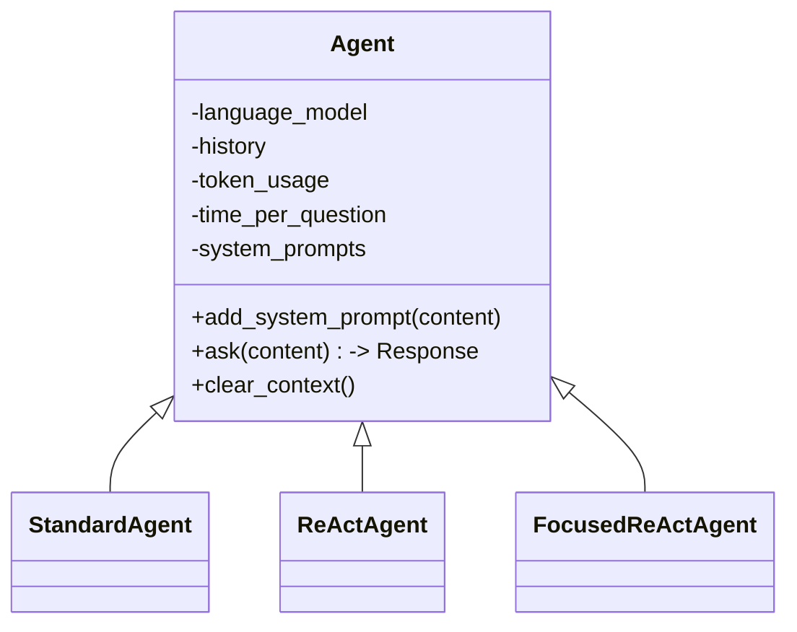

# ReAct Agent

The main components of the project are

- **Models**
  - Gemma 2 2B-IT
  - Qwen2.5-3B-Instruct
  - Gemma 3 4B-IT
- **Agents**
  - _Standard_: provides the answer **without thinking**.
  - _Chain of Thoughts (CoT)_: provides the answer **with thinking**.
  - _ReAct_: vanilla ReAct agent with **loop of reasoning and actions**.
  - _Focused ReAct_: ReAct with **reiteration of the initial question** and
    **early stopping**.
- **Tools**
  - _Search_: a retrieval system that can be **sparse** or **dense** and can be
    used by generating the string `Search[query]`. Major doubts and technicalities
    are discussed later.
  - _Calculate_: used by generating the string `Calculate[expression]` and I
    think plain Python `eval` function should be enough.
- **Datasets**
  - _HotPotQA_: question answering.
  - _GSM8K_: world mathematical problems.
- **Evaluation**
  - _Exact match_: just perfect overlap -> 0 or 1.
  - _Precision_: how many of the answer tokens are correct over the total number
  of generated tokens.
  - _Recall_: how many tokens of the ground truth answer have been generated.
  - _F1 score_: harmonic mean between precision and recall.
  - _Token usage_: not sure here but we can divide the tokens in
    - **Input** composed by
      - Question tokens
      - Observation tokens (just for ReAct based approaches)
    - **Output**: composed by
      - Thinking tokens
      - Output tokens
  - _Time latency_: I would just take the time the agent needs to deliver an
    answer starting from the time the question is submitted (end-to-end time for
    each question basically).

## Language Model

The things to take into account for different model evaluations are not very but
I would define a core `LanguageModel` class for this in the style of what I
already pushed on GitHub.

This class should be a low-level interface that every agent just uses (not
inherit) in order to handle the 2 main components of each model: **tokenizer**
and the actual **model**.

I want to highlight that this class is not an Agent, its only purpose is to
low-level tasks that are common for every model used. The main capabilities are
_tokenization_ and _generation_.

This class **does not** hold any history or state relative to past inputs; view
it as a function.

### Tokenizer

Each model has its own tokenizer and this affects how the thinking is formatted

> [!example]
> Qwen3 uses something like
> 
> ```text
> <think>the thinking whole thinking process</think>`
> ```
>
> while Gemma 2 uses
>
> ```text
> Thinking... [ internal thinking process ] ...done Thinking! [ final answer ]
> ```

So in order to be able to switch the model just by changing an input parameter e.g.

```python
agent1 = Agent("Qwen")
agent2 = Agent("Gemma")
```

we should have a **parser** that handles all the possible cases (for the models
we will use of course).

> [!important] Why we need this?
>
> - To run some token-related analysis it's important to separate thinking
> tokens from output tokens.
> - In this way is possible to tokenize the input and the output and retrieve
> both the tokenized and the plain-text versions. The first is used for metrics
> evaluation the second for visualization.
> 
> The main reason for this design is that we don't need to fetch the tokenizer
> on the fly in order to encode or decode something at need which will result in
> a mess of a code (at least for me).

### Model

Not much to say on this, should be viewed as just a mathematical function:

$$ \text{model(input text)} \to \text{output text} $$

It will be the agent that handles _what is the input_: can be a single question,
the whole chat history, the whole ReAct trajectory and so on.

The core idea for this `LanguageModel` class is to have a `generate()` method
that implements the function above but returns a **structured output** like:

```python
# just an example not a real implementation
class Response: 
	plain_input: str
	tokenized_input: torch.Tensor
	
	plain_thinking: str
	tokenized_thinking: torch.Tensor
	
	plain_output: str
	tokenized_output: torch.Tensor
```

Also we can decide to have something even more structured like a `TokenUsage`
class or something.

## Agent

I figure this as a classic inheritance scheme where there is an `Agent` class on
top that is basically an interface or a base class and then we will have like 3
main implementations: `StandardAgent`, `ReActAgent` and `FocusedReActAgent`.



Each class basically shares the same methods but they can differ in the actual
implementation and internal state handling.

> [!note]
> Of course the main method will be the `ask()` that will change based on the type
> of model (for ReAct I imagine the control loop is inside there).

> [!important]
> Regardless the type of agent, each one should have a `LanguageModel` instance
> that uses for all things described in the previous section.
> 
> The agent is encharged to handle the state (history, context, statistics etc.)
> and implement the main logic (e.g. ReAct loop).
